<div align="center">



</div>

```text
*** ADITZEL BASIC V2 ***
25+ YEARS UP. 7 COUNTRIES.

READY.
LOAD "WHOAMI",8,1
LOADING...
READY.
RUN
```

**Agents write most of the code now. The hard part is knowing it's right.**

I'm an engineering leader, and my current quest is rebuilding the software development lifecycle for the agentic age. Two things hold my attention: **software factories** (spec in, verified change out) and **automated verification** strong enough that a human only has to hold the last gate.

---

### `> PLAYER 1`

| | |
|---|---|
| **CLASS** | Senior Director of Software Engineering |
| **GUILD** | Alarm.com |
| **SPAWN POINT** | Madrid, ES → 7 countries → Metro D.C. |
| **TONGUES** | English · Español · 日本語 (学習中) |
| **ONLINE SINCE** | GitHub class of 2011 |
| **ORIGIN STORY** | Video games first. Then the code behind them. |

---

### `> THE FACTORY FLOOR`

<div align="center">



</div>

A factory is only as good as its gates. Anyone can make agents produce code faster. The interesting problem is proving the output is right without a person reading every line.

**House rules**

- Agents write most of the code. A human holds the gate to production.
- Red, green, refactor. A bug fix starts with a failing test, and no test gets deleted to make a build pass.
- Done means lint, types, tests and build all pass with zero warnings.
- Coverage is gated on the diff, not just the project.
- Build once, then promote the same artifact.
- Nothing may depend on one model, one vendor or one harness.

---

### `> NOW PLAYING`

```text
QUEST LOG
[ ] How far does "spec in,
    verified change out"
    really go?
[ ] Verification that scales
    with agent output
[ ] Blind bake-offs of AI
    code reviewers
[ ] Same task, different
    harness: who wins?
[ ] Plumbing for every
    harness: MCP gateways,
    shared agent memory
```

---

### `> INVENTORY`

| SLOT | EQUIPPED |
|---|---|
| **Models** | GPT · Claude · Gemini · Grok · GLM-5.3 · Kimi K3.1 |
| **Harnesses** | Claude Code · Codex CLI · Cursor CLI · OpenCode · Kimi Code · Kilo Code · Droid · Hermes · Pi · T3 Code |
| **Factories tried** | Warp · JetBrains · Augment · Cursor · Gas City · one I built myself |
| **Gates** | TDD · diff coverage · Playwright E2E · AI review (CodeRabbit, Codex) · Buildkite · GitHub Actions |
| **Plumbing** | MCP · [mcp-squared](https://github.com/aditzel/mcp-squared) · agent memory (Hindsight, MuninnDB) · AGENTS.md |
| **Languages** | TypeScript · Python · Java · JavaScript · C · C++ · Perl |

---

### `> HIGH SCORES`

| CARTRIDGE | WHAT IT DOES | |
|---|---|---|
| [**mcp-squared**](https://github.com/aditzel/mcp-squared) | MCP² control plane. Shows agents the tools they need instead of every tool schema at once. | TypeScript |
| [**hermes-muninndb-plugin**](https://github.com/aditzel/hermes-muninndb-plugin) | MuninnDB-backed memory provider for Hermes Agent. | Python |
| [**wavespeed-cli**](https://github.com/aditzel/wavespeed-cli) | CLI for the Wavespeed AI API, built with Bun. | TypeScript |
| [**project-settings-sync**](https://github.com/aditzel/project-settings-sync) | Encrypted `.env` sync across machines. | TypeScript |
| [**arena-dodger**](https://github.com/aditzel/arena-dodger) | Godot 4.7 arena dodger with an agent harness. | GDScript |

**Classic cabinet (2013, archived):** [spring-security-csrf-filter](https://github.com/aditzel/spring-security-csrf-filter) ★67 and [spring-security-csrf-token-interceptor](https://github.com/aditzel/spring-security-csrf-token-interceptor) ★49.

---

### `> ACTIVITY.LOG`

<div align="center">


</div>

---

```text
"Don't want to get paged at 3am?
 Make better technical
 decisions."

"Let's not wear pants
 on our head."

🇪🇸 🇨🇱 🇩🇪 🇺🇸  今日も頑張ります。

GAME OVER
CONTINUE? 9 8 7 6 5 ...
> INSERT COIN
```

<div align="center">

[](https://linkedin.com/in/allan-ditzel)
[](https://www.allanditzel.com)

</div>
